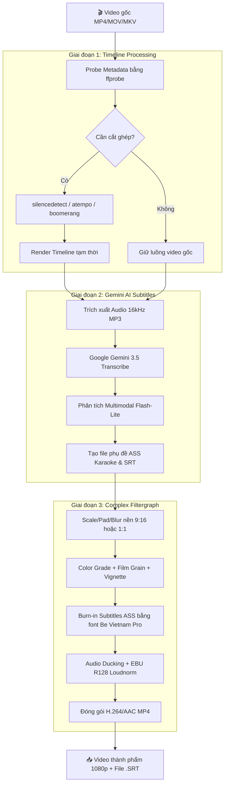

<div align="center">

# 🎬 VideoStudio

### **Biên tập & Tự động hóa video theo mẫu chuyên nghiệp với FFmpeg & Gemini AI**

*Biến video thô thành sản phẩm hoàn thiện cho TikTok, YouTube Shorts, Reels và Podcast chỉ với 1 cú click.*

[](https://nodejs.org/)
[](https://ffmpeg.org/)
[](https://ai.google.dev/)
[](https://expressjs.com/)
[](https://opensource.org/licenses/MIT)
[](https://github.com/MinhNhan2010/StudioVideo/pulls)

[Tính năng nổi bật](#-tính-năng-nổi-bật) •
[Mẫu dựng sẵn](#-danh-sách-mẫu-templates-có-sẵn) •
[Kiến trúc Pipeline](#-kiến-trúc-pipeline-xử-lý) •
[Cài đặt & Chạy](#-hướng-dẫn-cài-đặt--khởi-chạy) •
[Phím tắt](#-bảng-phím-tắt-pro-shortcuts) •
[Bảo mật & Riêng tư](#-bảo-mật--quyền-riêng-tư)

---

</div>

## 💡 Giới thiệu

**VideoStudio** là studio biên tập video tự động chạy cục bộ (Local-first) trên máy tính của bạn. Không cần cài đặt phần mềm dựng phim phức tạp (Premiere, CapCut, DaVinci), không tốn phí thuê bao hàng tháng, không xếp hàng chờ đợi trên máy chủ đám mây.

Bạn chỉ cần: **Kéo thả video thô** ➔ **Chọn phong cách mẫu (TikTok, Điện ảnh, Podcast...)** ➔ **Xem trước trực tiếp (Live Preview)** ➔ **Xuất video chuẩn 1080p kèm phụ đề Karaoke AI**.

---

## 🌟 Tính năng nổi bật

### 🎙️ 1. Phụ đề AI & Hiệu ứng Karaoke chuẩn từng từ
- Tích hợp model **`gemini-3.5-transcribe`** với độ chính xác cao cho tiếng Việt và đa ngôn ngữ.
- Nhận diện **Word-level Timestamps** (mốc thời gian từng từ) để tạo hiệu ứng chữ nhảy Karaoke ASS mượt mà.
- **Multimodal Video Understanding (`gemini-3.5-flash-lite`)**: Tự động phân tích nội dung khung hình, nhận diện từ khóa (keywords) để highlight màu nổi bật, gắn icon/emoji ngữ cảnh và tự động căn vị trí phụ đề thông minh tránh che mặt người nói.
- Bộ biên tập phụ đề tích hợp sẵn trong UI: dễ dàng chỉnh sửa chính tả, xoá câu thừa trước khi xuất video. Hỗ trợ tải riêng file `.SRT`.

### ⚡ 2. Cắt khoảng lặng tự động (Smart Jump Cut)
- Thuật toán phân tích âm thanh FFmpeg `silencedetect` phát hiện chính xác các khoảng ngập ngừng, ậm ừ, thở dài.
- Tự động ghép nối các đoạn nói liền mạch với độ trễ chuyển đoạn tự nhiên (padding mượt mà), biến video nói chuyện dài dòng thành clip ngắn gọn, nhịp điệu nhanh chuẩn phong cách Shorts/TikTok.

### 🎨 3. 13+ Mẫu giao diện & Bộ lọc Cinematic chuẩn Studio
- Tự động chuyển đổi tỷ lệ khung hình: **9:16 (TikTok/Shorts/Reels)**, **16:9 (Ngang/YouTube)**, **1:1 (Instagram)**, **4:5**.
- Chế độ **Background Blur (Nền mờ)** thông minh: biến video quay ngang thành video dọc 9:16 mà không bị cắt mất chi tiết quan trọng.
- Hiệu ứng màu điện ảnh: **Teal & Orange Hollywood**, **Vintage Film 35mm**, **B&W tương phản cao**, **Vivid rực rỡ**, **Tông ấm Vlog**.
- Hạt phim (Film Grain), làm mờ viền góc (Vignette), vệt đen điện ảnh (Letterbox), hiệu ứng chuyển cảnh Fade in/out.

### 🔊 4. Xử lý âm thanh & Nhạc nền chuyên nghiệp
- **Audio Ducking**: Tự động hạ âm lượng nhạc nền khi phát hiện giọng nói của nhân vật và nâng nhạc lên khi dứt câu.
- **Chuẩn hoá âm lượng (EBU R128 Loudness Normalization)**:
  - `-14 LUFS`: Chuẩn tối ưu cho TikTok, YouTube Shorts, Reels.
  - `-16 LUFS`: Chuẩn Apple Podcasts.
  - `-23 LUFS`: Chuẩn truyền hình / broadcast.

### 👁️ 5. Trình xem trước tức thì (Live Preview Simulator)
- Không cần render trước: Sử dụng Canvas và CSS Shaders mô phỏng hiệu ứng màu, tỷ lệ 9:16, hạt phim, chữ tiêu đề, watermark và phụ đề chạy trực tiếp trên video gốc theo thời gian thực.
- Tính năng **Xem trước 8s**: Dựng nhanh một phân đoạn ngắn từ điểm phát để kiểm tra chính xác kết quả FFmpeg trước khi xuất toàn bộ video.

### ✂️ 6. Timeline trực quan & Lưu mẫu cá nhân
- Thanh Timeline hiển thị dải hình thu nhỏ (Thumbnail Filmstrip), kéo thả 2 tay cầm để cắt đầu/cuối chính xác từng mili-giây.
- Tab **Tinh chỉnh (Tune)** cho phép can thiệp từng thông số kỹ thuật (độ bão hòa, âm lượng, font chữ, độ phân giải...).
- Nút **Lưu thành mẫu**: Tạo và lưu lại công thức edit yêu thích của riêng bạn vào thư viện cá nhân.

---

## 🎭 Danh sách mẫu (Templates) có sẵn

| Mẫu | Nhãn | Tỷ lệ | Điểm nhấn hiệu ứng |
|:---|:---:|:---:|:---|
| 🔥 **TikTok Viral** | `9:16` `AI Phụ đề` `Jump cut` | 9:16 | Nền mờ, màu rực Vivid, cắt sạch khoảng lặng, phụ đề nhảy chữ Karaoke neon, watermark |
| ▶️ **Shorts Gọn Gàng** | `9:16` `AI Phụ đề` | 9:16 | Crop tràn màn hình dọc, phụ đề nền đen tương phản cao, chuyển cảnh fade mượt |
| 🎙️ **Podcast / Talking** | `Jump cut` `AI Phụ đề` | Giữ nguyên | Cắt lặng gắt theo nhịp nói, màu ấm áp da mặt, phụ đề karaoke nổi bật |
| 🎬 **Điện Ảnh (Cinematic)** | `Màu phim` | Letterbox | Tone màu kinh điển Teal & Orange, viền đen 2.35:1, hạt phim 35mm, tiêu đề mở đầu |
| 📼 **Phim Cũ Retro** | `Màu phim` | Giữ nguyên | Tone màu vintage hoài niệm thập niên 80s, grain dày, viền tối vignette nghệ thuật |
| 🖤 **Đen Trắng Nghệ Thuật** | `Màu phim` | Giữ nguyên | Monochrome đen trắng sâu, tăng tương phản sắc cạnh, phù hợp video suy ngẫm |
| ☀️ **Vlog Tươi Sáng** | `Âm nhạc` | Giữ nguyên | Tone màu rực rỡ, tiêu đề chào đầu, outro kết thúc, tự động né nhạc khi nói chuyện |
| 🌸 **Slow-mo Mơ Màng** | `Tốc độ` | Giữ nguyên | Giảm tốc độ 0.5x, hiệu ứng phát sáng mờ ảo dreamy |
| ⏩ **Timelapse** | `Tốc độ` | Giữ nguyên | Tăng tốc 4x, tự động tắt âm thanh gốc, sẵn sàng ghép nhạc beat nhanh |
| 🔁 **Boomerang** | `Tốc độ` | Giữ nguyên | Lặp tới lui 2.5 giây tạo hiệu ứng giật mắt hút tương tác mạng xã hội |
| 🌧️ **Moody Trầm Buồn** | `Màu phim` | Giữ nguyên | Hạ độ bão hòa, sắc lạnh điện ảnh cho video tâm trạng, chill, storytelling |
| 📸 **Instagram Vuông** | `1:1` | 1:1 | Khung vuông 1080x1080 nền mờ chuyên dụng cho bài post Feed Instagram/Facebook |
| ✨ **Tự Do (Custom)** | `Tuỳ biến` | Tự do | Khởi đầu từ nguyên bản, tự do bật/tắt mọi bộ lọc theo gu thẩm mỹ cá nhân |

---

## 🏗️ Kiến trúc Pipeline xử lý

VideoStudio hoạt động theo kiến trúc 3 giai đoạn xử lý tối ưu, kết hợp tiến độ luồng thực qua **Server-Sent Events (SSE)**:



---

## 🚀 Hướng dẫn cài đặt & Khởi chạy

### Yêu cầu hệ thống
- **Hệ điều hành**: Windows 10/11, macOS, hoặc Linux.
- **Node.js**: Phiên bản `18.0.0` trở lên ([Tải tại nodejs.org](https://nodejs.org/)).
- *(Không cần cài đặt FFmpeg thủ công: Hệ thống đã đóng gói sẵn `ffmpeg-static` và `ffprobe-static` tự tương thích nền tảng).*

### 1. Clone repository về máy
```bash
git clone https://github.com/MinhNhan2010/StudioVideo.git
cd StudioVideo
```

### 2. Cài đặt các gói phụ thuộc
```bash
npm install
```

### 3. Cấu hình Gemini API Key *(Tuỳ chọn - dùng cho phụ đề AI)*
Lấy API key hoàn toàn miễn phí tại [Google AI Studio](https://aistudio.google.com/apikey):
- **Cách 1 (Khuyên dùng)**: Nhập trực tiếp vào biểu tượng **⚙ Cài đặt** trên thanh điều hướng web (Key được lưu an toàn tại máy của bạn: `data/settings.json`).
- **Cách 2**: Đặt biến môi trường hệ thống:
  ```bash
  # Windows PowerShell
  $env:GEMINI_API_KEY="AIzaSy..."

  # Linux / macOS
  export GEMINI_API_KEY="AIzaSy..."
  ```

### 4. Khởi chạy ứng dụng

```bash
# Khởi động máy chủ
npm start
```
*Hoặc trên Windows: Bạn chỉ cần bấm đúp chuột vào file **`start.bat`**.*

Mở trình duyệt truy cập: **`http://localhost:5173`**

---

## ⌨️ Bảng phím tắt (Pro Shortcuts)

Để tăng tốc độ biên tập, VideoStudio hỗ trợ đầy đủ phím tắt thao tác nhanh:

| Phím tắt | Chức năng |
|:---:|:---|
| <kbd>Space</kbd> | Phát / Tạm dừng video |
| <kbd>←</kbd> / <kbd>→</kbd> | Tua lùi / tiến 1 giây |
| <kbd>Shift</kbd> + <kbd>←</kbd> / <kbd>→</kbd> | Tua nhanh 5 giây |
| <kbd>I</kbd> | Đặt điểm bắt đầu cắt (**Trim In**) tại vị trí con trỏ |
| <kbd>O</kbd> | Đặt điểm kết thúc cắt (**Trim Out**) tại vị trí con trỏ |
| <kbd>P</kbd> | Dựng & Xem trước nhanh 8 giây (**Preview 8s**) |
| <kbd>Ctrl</kbd> + <kbd>Enter</kbd> | Bắt đầu kết xuất toàn bộ video (**Export**) |
| <kbd>L</kbd> | Bật / Tắt chế độ mô phỏng hiệu ứng trực tiếp (**Live Mode**) |
| <kbd>M</kbd> | Bật / Tắt tiếng video (**Mute**) |
| <kbd>Esc</kbd> | Đóng ngăn lịch sử, phụ đề hoặc hộp thoại đang mở |

---

## 📂 Cấu trúc mã nguồn

```
StudioVideo/
├── assets/
│   └── fonts/             # Font chữ nhúng (Be Vietnam Pro SemiBold / ExtraBold)
├── public/                # Giao diện Web SPA (Zero-build, Vanilla JS/CSS)
│   ├── index.html         # Khung HTML semantic, bố cục Responsive
│   ├── styles.css         # Hệ thống Design Tokens, Dark Glassmorphism, Aurora
│   ├── theme-nghien.css   # Tùy biến bộ nhận diện phong cách cao cấp
│   └── app.js             # Client state management, player sync, Canvas Live FX
├── server/                # Máy chủ Node.js Backend
│   ├── index.js           # REST API endpoints, multipart upload, SSE job stream
│   ├── pipeline.js        # FFmpeg filtergraph builder & render orchestration
│   ├── subtitles.js       # Tích hợp Gemini 3.5 Transcribe & Flash analysis
│   ├── ffmpeg.js          # Promise-based child_process wrapper & ffprobe helper
│   └── templates.js       # Định nghĩa schema cấu hình và 13 mẫu dựng sẵn
├── scripts/               # Scripts kiểm thử & chẩn đoán
│   ├── smoke-test.mjs     # Smoke test toàn diện pipeline với video mẫu
│   └── test-video-analysis.mjs # Kiểm tra phân tích video bằng Gemini
├── tests/                 # Bộ kiểm thử tự động
│   ├── unit.test.mjs      # Kiểm thử đơn vị các hàm logic xử lý
│   └── api.test.mjs       # Kiểm thử tích hợp REST API
├── start.bat              # Script khởi chạy 1-click cho người dùng Windows
├── package.json           # Cấu hình dự án & dependencies
└── README.md              # Tài liệu hướng dẫn sử dụng
```

---

## 🧪 Kiểm thử (Testing)

Dự án đi kèm bộ test tự động để đảm bảo tính ổn định của pipeline dựng video:

```bash
# Chạy unit tests
npm run test:unit

# Chạy smoke test (tạo clip test & dựng thử nghiệm pipeline)
npm test

# Chạy API integration tests
npm run test:api

# Chạy toàn bộ các bài test
npm run test:all
```

---

## 🔒 Bảo mật & Quyền riêng tư

- **100% Xử lý Local**: Toàn bộ quá trình cắt ghép, áp màu, nén video, trộn âm thanh đều thực hiện trực tiếp trên CPU/GPU của máy tính cá nhân thông qua FFmpeg.
- **Không lưu trữ đám mây**: Video của bạn không bao giờ bị tải lên bất kỳ máy chủ bên thứ ba nào.
- **Bảo mật API Key**: Chỉ khi bạn bật tính năng *Phụ đề AI*, đoạn âm thanh ngắn mới được gửi qua kết nối bảo mật HTTPS trực tiếp tới Google Gemini API bằng chính API Key cá nhân của bạn. Key được lưu trữ cục bộ trong file `data/settings.json` và đã được loại trừ hoàn toàn khỏi Git.

---

## 🤝 Đóng góp phát triển (Contributing)

Mọi đóng góp nhằm nâng cấp tính năng, bổ sung mẫu màu mới hoặc tối ưu hóa hiệu năng đều được hoan nghênh:

1. Fork dự án (`git checkout -b feature/tinh-nang-moi`)
2. Commit thay đổi (`git commit -m 'feat: them mau phim cyberpunk'`)
3. Push lên nhánh của bạn (`git push origin feature/tinh-nang-moi`)
4. Tạo một **Pull Request** mới trên GitHub.

---

## 📄 Bản quyền (License)

Dự án được phân phối dưới giấy phép **MIT License** - xem chi tiết tại file [LICENSE](LICENSE) (nếu có) hoặc tự do sử dụng cho mục đích cá nhân và thương mại.

<div align="center">

**Phát triển bởi [MinhNhan2010](https://github.com/MinhNhan2010)**  
*Nếu dự án hữu ích, đừng quên tặng một ⭐ sao trên [GitHub](https://github.com/MinhNhan2010/StudioVideo) nhé!*

</div>
